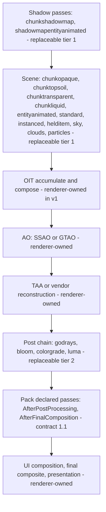

# Shader packs

Design for **PACK-01** in the [roadmap](ROADMAP.md). Status: contract 1 is
implemented as the first slice - pack discovery, the `pack.json` manifest, option
defaults as defines, per-program substitution through the shipped library, and
per-slot fallback (`ShaderPackManifest`, `ShaderPackLibrary`, and the pack branch
in `VulkanDevice.LinkProgram`; `samples/shaderpacks/example.tint` proves it).
Declared passes, pack targets, pack textures, the Options UI and the
OptiFine/Iris adapter are not implemented; the sections below say so where it
matters. The design builds on [rendering](rendering.md), the
[mod integration](mod-integration.md) pass API and the
[architecture](architecture.md) ownership rules.

A shader pack is data: a manifest, GLSL 450 sources for programs that already
exist in the renderer, optionally image files, and a declaration of extra
full-screen passes. Packs never schedule game draws, never replace the frame
loop, never call into game state and never ship compiled binaries. They are the
native shader contract of `shaders/native` plus the declared-pass contract of
`VulkanStory.Game.ModRendering`, made public and versioned.

Non-goals for v1:

- Loading OptiFine/Iris-format packs. That is a separate adapter that would
  synthesize this contract; the gaps it must close are listed at the end.
- Replacing temporal reconstruction, ambient occlusion internals, upscaling,
  frame generation, UI composition or presentation.
- Arbitrary UI scripting. Pack options are declarative values.
- Per-pack scripting or code execution of any kind.

## Where packs sit



Program identity is the game's shader asset name (`ShaderProgram.PassName`), the
same key `NativeShaderLibrary` and `ShaderOverridePolicy` already use; the
existing `sceneMotionWriters` list is the precedent for certifying a program by
name. A pack replaces one program at a time or none at all. Contract 1 resolves
any slot name the shipped manifest carries; the tiers below say which slots the
pipeline serves well today, and the renderer-owned row is the hard boundary.

## Contract

### A. Program slots

Tier 1 and tier 2 slots exist today as native programs. A pack's source is
reflected and checked against the set convention when it builds, and it must
honor the slot's mandatory outputs, including motion when TAA is active.

| Tier | Slot (program name) | Writes |
| --- | --- | --- |
| 1 | `chunkopaque`, `chunktopsoil` | primary color, glow, G-buffer normals/position, motion |
| 1 | `chunktransparent` | OIT accumulation/revealage/glow, motion |
| 1 | `chunkliquid`, `chunkliquiddepth` | primary, liquid depth |
| 1 | `entityanimated`, `standard`, `instanced` | primary, glow, motion |
| 1 | `helditem` | primary, glow, motion |
| 1 | `sky`, `nightsky`, `celestialobject`, `cloudmap`, `cloudvolumetric` | primary, glow |
| 1 | `particlesquad`, `particlesquad2d`, `particlescube` | primary, glow, motion |
| 1 | `chunkshadowmap`, `shadowmapentityanimated` | shadow cascades |
| 2 | `scene-ssao`, `scene-godrays`, `godrays`, `bloom` sources, `colorgrade`, `luma`, `transparentcompose` | effect targets at defined stages |
| — | `taa-*`, GTAO compute, `fsr-*`, `gui`, `ui-compose`, `final`, `blit` | renderer-owned, not replaceable |

Renderer-owned stages stay whole-stage operations: a pack cannot inject between
GTAO's internal passes, and cannot replace the upscaler chain. Tier 2 slots are
replaced only where the current stage exists; a missing optional effect target
skips the pack's slot the same way declared passes skip missing targets.

### B. Inputs

A pack program receives exactly what a native program receives today, documented
once in `shaders/native/include/bindings.glsl` and
`VulkanStory.Render.Vulkan/Shaders/SetConvention.cs`:

| Set | Contents |
| --- | --- |
| 0 | `FrameGlobals` (fog/light, shadow matrices, warps, sky, color map, point lights), shadow maps, sky, glow, liquid depth |
| 1 | bindless typed sampler arrays; slot indices come from the 128-byte push block declared with `OPTIMUM_SAMPLER_SLOT` |
| 2 | face data, animation pair, program record (dynamic UBO, binding 3), up to four extra named blocks (bindings 4–7) |
| push | texture slots and per-draw scalars, ≤ 128 bytes |

Vertex inputs, varyings and fragment outputs use the reserved locations in
`shaders/native/include/varyings.glsl`. `TAAMOTION` and `TAAMOTIONLOCATION` are
stamped by the adapter; a geometry replacement that does not write motion at the
location is certified as non-motion and TAA declines it, exactly like
`SceneShaderLinked` does for the shipped writers today.

Pack-provided textures (Iris-style custom textures and `noisetex`) are a
follow-up: declared in the manifest as sampler name, GLSL type, image path and
filter/wrap hints, uploaded through the existing texture registry and addressed
as set 1 slots. Not part of the first spike.

### C. Pack passes

Pack passes reuse `VulkanStoryPassDecl` unchanged: slot, read/write attachment
handles, motion declaration and validation are the public contract already
documented in [mod integration](mod-integration.md). Pack-specific additions:

- A pack may declare **pack targets** in its manifest (name, format from a
  supported list, scale, clear-on-first-use, mip count) and read/write them at
  its declared stages, alongside the existing attachment handles.
- Pack targets participate in the same frame-graph lifetime, barrier and
  retirement rules as existing optional targets. They are allocated when the
  pack activates and released when it deactivates.
- Pack passes run in registration order after a slot's ordinary renderers,
  matching today's declared-pass behavior; they cannot open the shadow stages.

This is PACK-01 item 5 and the only structurally new renderer work. It stays
gated on REN-09 (framebuffer rebuild instability) and on the OIT decision below.

### D. Options

The manifest declares user options; the loader resolves them and splices them as
a `#define` prefix into every source it compiles, so option-dependent branches
are ordinary compile-time branches:

```json
{
  "contract": 1,
  "id": "example.tint",
  "name": "Example tint",
  "version": "0.1.0",
  "options": [
    { "id": "PACK_TINT", "type": "bool", "default": true },
    { "id": "QUALITY", "type": "choice", "values": ["low", "high"], "default": "high" }
  ],
  "programs": [
    { "slot": "chunkopaque", "source": "shaders/chunkopaque.glsl" }
  ]
}
```

`bool` becomes `0` or `1`; `choice` becomes the value's index. A program source
uses the same one-file-two-stages form as `shaders/native` (`OPTIMUM_VERTEX` /
`OPTIMUM_FRAGMENT`). The loader refuses unknown manifest fields, so `profiles`,
`targets` and `passes` are contract 1.1 work rather than silently ignored.

Until options are selectable in the Options menu (implementation plan 3), the
defaults apply; the sample pack documents how to compare values by editing a
default. Persistence will follow the existing settings model
(`ModConfig/vulkanstory.json`), with per-pack values stored beside the pack
selection.

### E. Failures and fallback

| Failure | Behavior |
| --- | --- |
| Invalid manifest, unknown field, another contract version, bad path, missing file | The pack is refused with the reason in `NativeShaderStatus` and the log; no pack is active |
| A declared slot is not a shipped program | The pack is refused; contract 1 replaces shipped programs, it does not add them |
| A program source fails to build (compile, reflection or set convention) | That slot falls back to the shipped program at load, the pack stays loaded, and the log names the slot and the first error (PACK-01 item 3) |
| Option change fails to compile | With the options UI (plan 3): the affected slot keeps its previous stage set and the new value stays visible with an error marker |
| Pack target allocation fails | With pack targets (plan 2): passes writing it are skipped, the pack stays loaded |
| Runtime device loss | Existing device-loss path; packs rebuild with the device |

Contract 1 builds the pack synchronously at device start, before any program
links, so the world never sees a half-activated pack; hot reload, when it lands,
stages replacements the same way: the previous stage set keeps rendering until
the replacement has linked, mirroring the asynchronous pipeline behavior the
renderer already uses.

### F. Loading and caching

- A pack is a directory under `shaderpacks/` beside the runtime
  (`<game>/VulkanStory/shaderpacks/<id>/`), or any absolute directory;
  zips are not part of contract 1. `VULKANSTORY_VK_SHADER_PACK` names the pack's
  id or directory; the Options menu carries the same selection once the pack UI
  lands. One pack is active at a time.
- The loader materializes a build tree under
  `<shader cache>/vulkanstory-vulkan/shaderpacks/<id>-<hash>/`: the pack's
  sources renamed to their slot names, plus the runtime's embedded copy of
  `shaders/native/include`, then compiles it with `NativeShaderBuilder`, the
  same compiler the offline tool and `VULKANSTORY_VK_SHADER_SOURCE` use. The
  hash covers the manifest, resolved options, sources and compiler identity, so
  a changed pack rebuilds and an unchanged one reuses its tree.
- Hot reload and per-pack options in the Options menu are later steps (plan 3).
- The pack's content hash joins the binary cache key when pack options become
  user-selectable; the shipped pipeline cache already keys by program and
  settings identity.
- `NativeShaders = false` disables the native path entirely; a selected pack is
  then reported as not loaded.

## Which layouts become public

PACK-01 item 1, answered by the tables above: the frame globals block and its
frame textures, the bindless slot convention, the program record and named-block
range, push-constant layout, reserved varying locations, the motion attachment
contract, shadow cascade sampling (two comparison-sampled cascades), the OIT
attachment pair, and the declared-pass attachment handles. Internal stage
scheduling, barrier placement, descriptor update, transient lifetimes and every
renderer-owned pass stay private.

Contract version is the manifest `contract` field; a pack that wants bindings
beyond this surface (more named blocks, more texture slots per draw) is refused
until a later contract revision raises the limits deliberately.

## Interactions

- **Mod shader overrides.** A third-party asset override currently makes the
  rewriter take over and declines the native program. Proposal: mod override >
  pack > native, with the declined pack slot reported. A mod that deliberately
  replaces a program outranks an installed pack; the reverse would break mods
  silently.
- **Mod declared passes.** They keep working; pack passes and mod passes share
  the same registry and ordering rules.
- **Translucency.** v1 keeps OIT and exposes its accumulation/revealage
  programs; a pack that wants blended translucency is a later contract addition
  with a per-pack translucency mode, because the scene depth contract differs.
- **Temporal.** Packs read motion and depth; they never write motion outside
  the existing motion-writer declaration, and TAA/GTAO keep their own sample
  policy. Frame generation and upscalers consume pack output unchanged.
- **Platforms.** macOS through MoltenVK lacks geometry shaders; a pack
  requesting features the active device does not expose is refused at load with
  the missing feature named.
- **Performance.** Pack targets count toward framebuffer rebuilds and memory
  budgets. Packs land after the REN-09 fixes, and a pack is off by default.

## OptiFine / Iris compatibility tier (deferred)

Running existing Minecraft packs is a translation problem on top of this
contract, not a second renderer. What an adapter would have to supply, from the
Iris documentation set and the pack format:

1. **Legacy GLSL lowering** for `#version 120`/`130` sources and compatibility
   built-ins (`gl_Vertex`, `gl_ModelViewMatrix`, `gl_TextureMatrix`, `texture2D`,
   `ftransform`, `gl_FragColor`). The mapping is documented; today's rewriter
   handles GLSL 330 declarations only and has none of this.
2. **Attribute synthesis**: `mc_Entity` block id, `at_midBlock`, tangents and
   Iris lightmap coordinates. VS chunk geometry carries position, atlas UV,
   packed normals, RGBA light and render flags; identities must be derived (for
   example from the tesselator or UV-to-texture tables). Approximation, not
   parity.
3. **Light semantics**: VS light is per-vertex colored, so a single 2D lightmap
   cannot express it; pack shaders expecting MC lightmap sampling need a shim
   that injects VS light per fragment.
4. **Content tables**: `block.properties` / `entity.properties` ids map MC
   content names that VS does not have. Generic effects transfer; per-block
   behavior needs alias tables or VS-authored packs.
5. **Program taxonomy**: mapping MC program categories onto the slot table
   above (for example `gbuffers_terrain` onto `chunkopaque`/`chunktransparent`)
   plus `shaders.properties` parsing (orderings, blends, scales, sizes).

Iris is LGPL-3.0; an adapter should be implemented against the public format
documentation (Iris Docs, ShaderDoc), not ported from Iris source, and packs are
user-supplied. This tier starts only after our own packs exist and at least one
hand-written pack proves the contract.

## Implementation plan

1. **Contract + substitution (done, contract 1).** `pack.json` parsing and strict
   validation, discovery under `shaderpacks/` beside the runtime, replacement of
   any shipped slot through `NativeShaderBuilder` and the shipped library, option
   defaults as spliced defines, per-slot fallback with refusal reasons, and a
   content-hashed build tree under the shader cache. `samples/shaderpacks/example.tint`
   proves it on `chunkopaque`; the mechanism is generic over shipped programs.
2. **Declared pack passes and pack targets.** Extend the pass registry with
   pack-owned attachments; prove state restore, lifetime and read-after-write
   at `AfterPostProcessing`.
3. **Options UI and hot reload.** Per-pack options become selectable and
   persisted; a command rebuilds the pack without restarting the world.
4. **Post-slot coverage and pack textures** (`noisetex`, custom textures): a
   pack-provided post fragment is the next proof after the tint sample.
5. **OIT policy and broader slot coverage** if a pack needs them.
6. **OptiFine/Iris adapter** as a separate milestone.

Evidence follows existing practice: headless harness on the foggy village save,
pack on and off, TAA on for motion certification, fallback deliberately
provoked, cache reuse measured, `.vulkanstory status` reporting pack state.

## Open questions

- Precedence: is mod override > pack > native right, or should a pack be able
  to pin a slot against mod overrides?
- Raise the named-block range (bindings 4–7 today) before offering pack
  buffers, or keep packs to the program record?
- Do packs need the `USESSBO = 0` attribute path, or is the SSBO face-data path
  the only supported target (packages specialize axes per pipeline)?
- Should pack targets be a new dynamic set or reuse the existing optional-target
  machinery with fixed names per stage?
- Does translucency stay renderer-owned for the entire 1.x contract?
